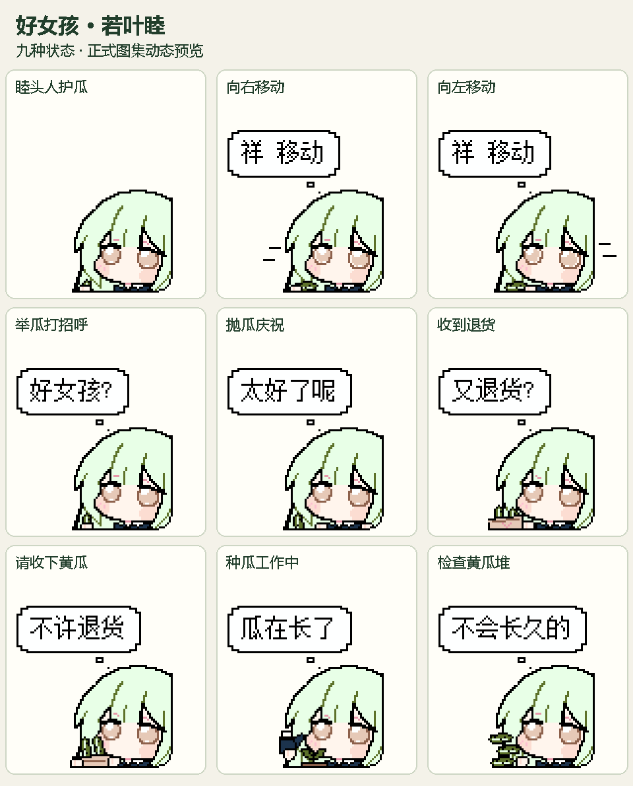

# 好女孩 · 若叶睦

以“好女孩”像素梗图为主视觉的 Codex / PetDex 兼容桌宠。小睦面无表情地护瓜、带瓜、送瓜，以及收到退货。

作品版本：**v1.0**。包含九种动作的 57 个有效帧和十六个注视方向，采用透明 PNG Sprite v2，图集为 1536×2288，每格 192×208。

- [打开本地逐帧预览](pets/wakaba-mutsumi-good-girl-pixel/package/preview.html)
- [成品及导入说明](pets/wakaba-mutsumi-good-girl-pixel/package/README.md)
- [逐动作画廊](pets/wakaba-mutsumi-good-girl-pixel/README.md)
- [创作来源、确认稿与代码](pets/wakaba-mutsumi-good-girl-pixel/creation/README.md)

人物保留原图裁切，使用黑色外轮廓和右下角像素圆弧；所有动作无嘴巴、双眼睁开。素材颜色限于参考图的原 12 色调色板。气泡有内容时才显示，显示宽度至少 96px 时，文字不小于 12px。

这是本地作品仓库，包含参考、代码、原生像素稿、正式图集、透明 GIF 与离线预览页。实际启用与动作触发由客户端控制。
