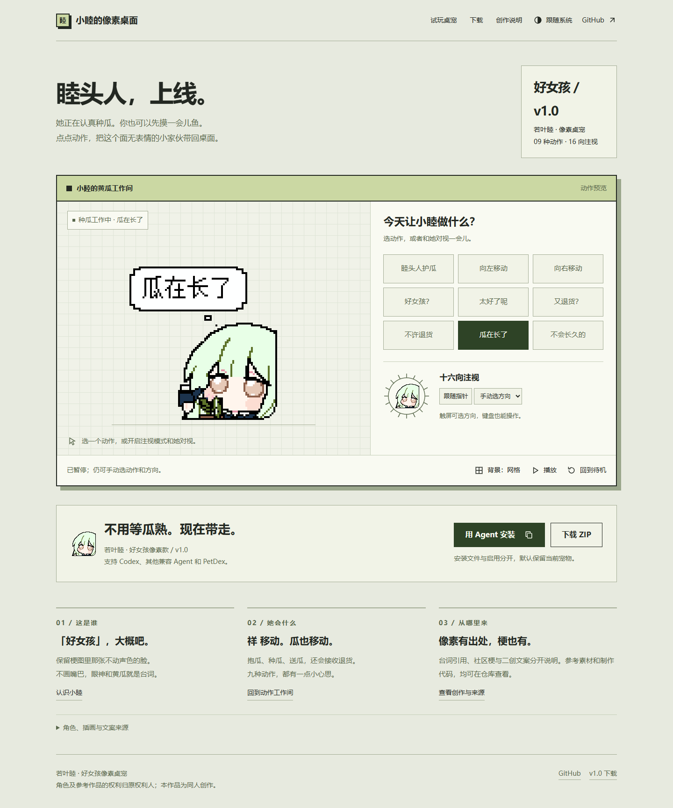
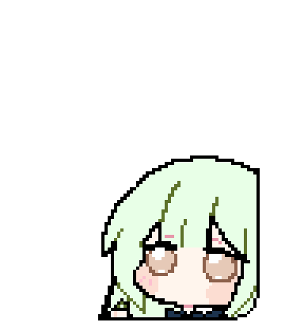
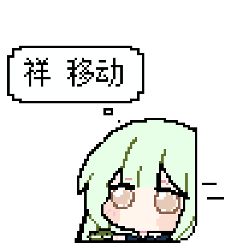
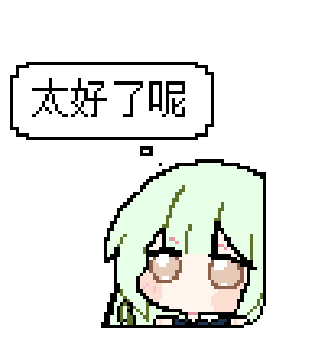
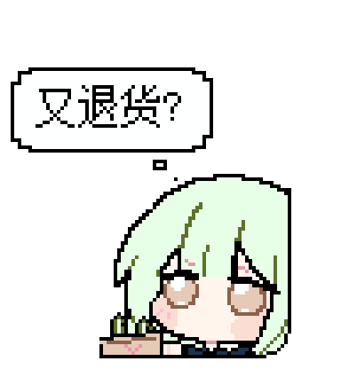
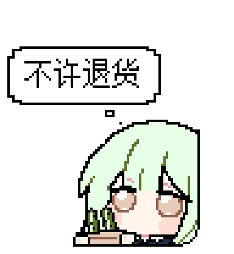
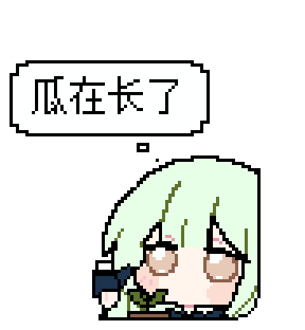
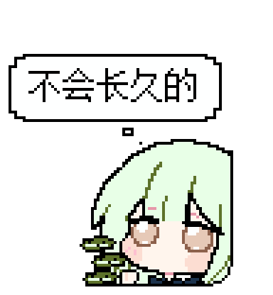

WAKABA MUTSUMI PETS · PIXEL ART

<h1 align="center">好女孩 · 若叶睦</h1>

面无表情，瓜事很多。 抱瓜移动、举瓜招手，认真种瓜，再把退回来的礼袋收好。

<b>01 款像素桌宠 · 09 种动作 · 16 个注视方向</b>

<a href="https://github.com/MIBXR/wakaba-mutsumi-pets/releases/download/v1.0/wakaba-mutsumi-good-girl-pixel-v1.0.zip">下载桌宠 v1.0</a> · <a href="#动作剧场">动作剧场</a> · <a href="#下载与安装">下载与安装</a> · <a href="#创作与来源">创作与来源</a>

## 认识小睦

这是一只以“好女孩”梗图为主视觉的若叶睦桌宠。保留原图右侧与下沿的裁切、浅绿色头发和棕色大眼睛，采用黑色外轮廓与右下角像素圆弧。所有动作都不画嘴巴，双眼保持睁开；有内容时，气泡才会靠近头部出现。

她的日常围绕黄瓜展开：“祥 移动”时把瓜抱紧，“好女孩?”时举瓜招手，礼袋递出去说“不许退货”，收到退货后又默默看你一眼。文案结合原片台词、社区梗与本作品的二创设计。

## 小睦的像素桌面

一个可以试玩的黄瓜工作间：九种动作、十六向注视、背景切换、暂停与深浅主题。安装指令支持 Codex、其他兼容 Agent 和 PetDex；默认保留当前启用的宠物。

[打开像素桌面](https://mutsumi-pixel-desktop.mibxranime.chatgpt.site/) · [网站源码与本地打开方式](site/README.md)

## 动作剧场

动图直接取自正式图集，点击可单独查看；实际触发和停留时间由客户端控制。

| 睦头人护瓜 | 祥 移动 · 向右 | 祥 移动 · 向左 |
| --- | --- | --- |
|  |  |  |

| 好女孩? | 太好了呢 | 又退货? |
| --- | --- | --- |
|  |  |  |

| 不许退货 | 瓜在长了 | 不会长久的 |
| --- | --- | --- |
|  |  |  |

### 十六向注视

身体构图和眼睛轮廓固定，利用视线变化表达方向。十六向注视供支持 Sprite v2 注视的客户端使用。

[观看全部动作总览](pets/wakaba-mutsumi-good-girl-pixel/package/previews/overview.gif) · [作品详情](pets/wakaba-mutsumi-good-girl-pixel/README.md)

## 下载与安装

| 当前作品 | 版本 | 下载 |
| --- | --- | --- |
| 若叶睦 · 好女孩像素款 | [v1.0](https://github.com/MIBXR/wakaba-mutsumi-pets/releases/tag/v1.0) | [便携 ZIP](https://github.com/MIBXR/wakaba-mutsumi-pets/releases/download/v1.0/wakaba-mutsumi-good-girl-pixel-v1.0.zip) · [解包成品](pets/wakaba-mutsumi-good-girl-pixel/package/) |

解压 ZIP 后，打开 `wakaba-mutsumi-good-girl-pixel/README.md` 查看导入说明，或用浏览器打开同目录的 `preview.html` 逐帧查看全部动画、切换尺寸和深浅背景。GitHub 文件页用于浏览源码，不直接运行此 HTML。

安装时先确认目标客户端：Codex 使用实际 `CODEX_HOME/pets/<slug>/`（默认 `~/.codex/pets/<slug>/`）；其他兼容 Agent 使用其文档或配置确认的宠物目录；没有适用目录时，可使用 PetDex 的 `~/.petdex/pets/<slug>/`。不要求存在 `codex` 命令。文件安装与选中启用分别核实，默认保留当前宠物。

正式图集为 **1536×2288** 的透明静态 PNG，每格 **192×208**，包含 **57 个动作帧与 16 个注视方向**。显示宽度至少 96px 时，气泡文字不小于 12px。[完整规格与安装说明](pets/wakaba-mutsumi-good-girl-pixel/package/README.md)

## 创作与来源

| 内容 | 入口 |
| --- | --- |
| 角色研究、台词出处、动作设计与署名 | [创作说明](pets/wakaba-mutsumi-good-girl-pixel/creation/README.md) |
| 用户提供的插画、54×54 像素参考及来源记录 | [参考素材](pets/wakaba-mutsumi-good-girl-pixel/creation/references/) |
| 已确认的形象与逐动作设计 | [设计图](pets/wakaba-mutsumi-good-girl-pixel/materials/design/) |
| 原生像素图集与动画映射 | [作品素材](pets/wakaba-mutsumi-good-girl-pixel/materials/) |
| 像素编辑及动画绘制代码 | [绘制源码](pets/wakaba-mutsumi-good-girl-pixel/creation/code/) |

本作按用户确认的方案用代码完成像素编辑、动画与打包，未使用 ImageGen，因此没有生成式图像提示词或 AI 生图原稿。54×54 源像素、原生图集与放大展示素材按各自用途保留。

角色来自 **Bushiroad / BanG Dream!**。像素底图来自[拼豆图鉴页面](https://pd.anqstar.com/drawings/drw_0a1c7d99d3e7cad76f807dff401fc335)，页面发布者为 **huolizi**；原插画作者与首次发布出处尚未核实。发布者身份不等同于原插画作者。角色及参考作品的权利归原权利人。
